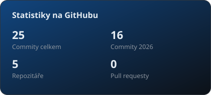
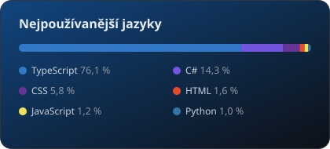

# Ahoj, jsem Adam 👋

**Full-stack vývojář · React, TypeScript & .NET**

Stavím rychlé a přehledné webové aplikace — od designu rozhraní přes API až po testy a nasazení.

---

### 🧰 Technologie

**Frontend**

  
  
  
  
  

**Backend a data**

  
  
  
  
  

**Kvalita a nástroje**

  
  
  
  
  

---

### 🚀 Vybrané projekty

| Projekt | Co to je | Technologie |
| :--- | :--- | :--- |
| **Český tábor** | Portál pro vyhledání a přihlášení dětí na letní tábory. Dashboardy pro rodiče, pořadatele i správce, platby přes QR kód a automatické párování plateb z bankovního výpisu (GPC/CSV). 149 automatických testů a CI. | React 19 · TypeScript · ASP.NET Core 9 · EF Core · SQLite |
| **FlowSync** | Týmový správce úkolů se synchronizací v reálném čase — Kanban, projekty, přiřazování členům týmu, CZ/EN. | React 19 · TypeScript · Cloud Firestore |
| **Putna Bar** | Web baru v Hradci Králové s rezervacemi přes Resos, interaktivním nápojovým lístkem a živým stavem „otevřeno/zavřeno“. | React 19 · Tailwind 4 · Framer Motion |
| **Frogo Shop** | Web CBD shopu a PS5 chill-roomu v Hradci Králové — výrazný „gaming“ design s neonovými efekty. | React 19 · Tailwind · Framer Motion |

Repozitáře projektů jsou soukromé — ukázku kódu rád pošlu na vyžádání.

---

### 📊 Statistiky

  
  

Počítá se i práce v soukromých repozitářích · aktualizuje se automaticky každý den.
